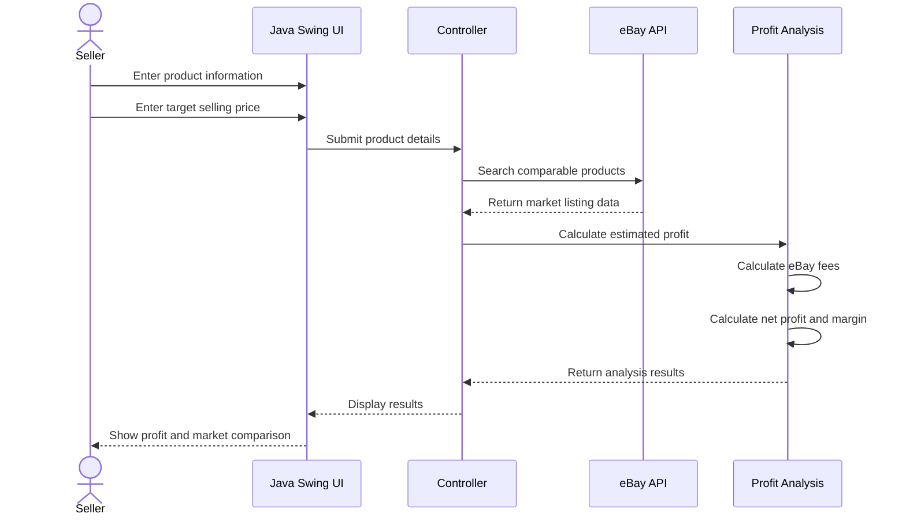
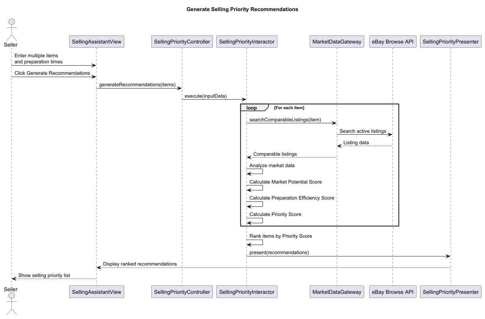
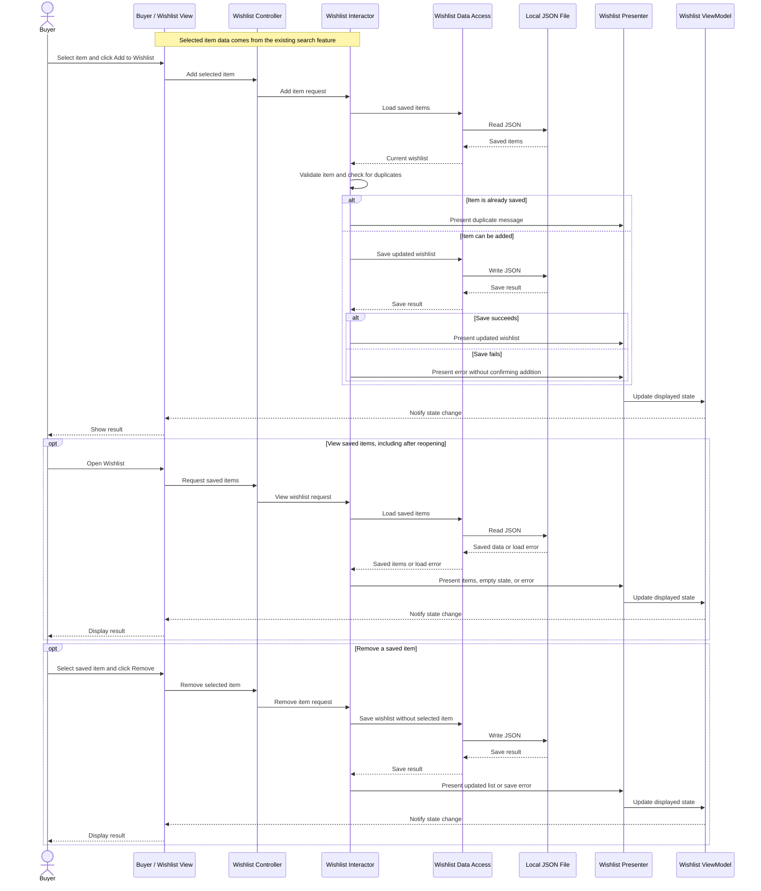

# Project Name
## Team Information
### Team Members
- Boheng Jia
- Reyna Qin
- Muhammad Mahd Khalid
- Jiayou Zhu
---
## Project Description
### Domain : Market Data Analysis 
This project aims to provide a cohesive and centralized access to eBay Market Data for use by both Sellers and Buyers, providing a more complete and intuivitive approach to market research on an item-to-item basis.   
---
## User Stories
### User Story 1: As a seller, I want to estimate an item's net profit based on its target price, market value, and selling costs so that I can make informed pricing decisions.
### User Story 2: As a seller who wants to sell multiple items, I want to receive a ranked list of selling priorities so that I can decide which items to sell first and use my time more efficiently.
### User Story 3: As a buyer, I'd like to view pricing and quality data for an item I'm considering purchasing so I can set realistic spending expectations.
### User Story 4: As a buyer, I want to save items to a wishlist and view them later so that I can keep track of items I am considering buying.
---
## Use Cases
### Use Case 1: Analyze Estimate Net Profit
Primary Actor: eBay Seller performing an item search and pricing analysis.

Preconditions:
 -The user is in the Seller view of the application.

Trigger: The seller enters a product name and their desired selling price into the system.

Success Outcome: The system retrieves relevant market data, calculates estimated selling costs and net profit, and presents pricing recommendations to the seller.

Main Success Scenario:
1. The seller enters a product name or keywords.
2. The system retrieves relevant product and historical market pricing data.
3. The system displays available market information, including historical prices and sales data.
4. The seller enters their target selling price.
5. The seller enters estimated shipping and packaging costs.
6. The system calculates applicable eBay fees and total selling costs.
7. The system calculates the estimated net profit and profit margin.
8. The system compares potential profits at different selling prices.
9. The system displays the final pricing analysis to the seller.

Extensions:

2a. No valid market data is found.
 -i. The system notifies the seller that no relevant market data is available.
 -ii. The seller can manually enter product pricing information or try another search.

5a. Some cost information is missing.
 -i. The system asks the seller to provide the missing information.
 -ii. The seller can enter the missing costs before continuing.

6a. The eBay API is unavailable.
 -i. The system displays an error message.
 -ii. The seller can retry the request or use available sample data.
### Use Case 2: Generate Selling Priority Recommendations
Primary Actor: Seller who wants to sell multiple items.

Preconditions:

- The user is in the Seller view of the application.

- The seller has multiple items they are considering selling.

Trigger: The seller chooses to analyze multiple items and generate a selling priority list.

Success Outcome: The system analyzes the available market information and the estimated preparation effort for each item, then presents a ranked list to help the seller decide which items to consider selling first.

Main Success Scenario:

1. The seller enters the names and relevant information of the items they want to sell.

2. The system retrieves comparable active listings for each item using the eBay Browse API.

3. The system analyzes available market indicators to estimate each item's market potential.

4. The seller enters the estimated preparation time required for each item.

5. The system combines the market potential and preparation efficiency scores to calculate an overall priority score for each item. The system ranks the items based on their priority scores.

6. The system displays the ranked list, helping the seller decide which item to list first.

Extensions:

- 2a. No comparable listings are found for an item. 
  - i. The system notifies the seller that sufficient market data is unavailable for that item.

  - ii. The item is excluded from market-based scoring or marked as having insufficient data.

- 5a. Insufficient market data is available for an item.

  - i. The system informs the seller that its market potential cannot be reliably evaluated.

  - ii. The system avoids presenting an unsupported market score for that item.
### Use Case 3: Get item pricing data
Primary Actor: Buyer performing an item search

Preconditions: 
- The user is in the Buyer view of the application.

Trigger: The buyer enters the name of the item they'd like pricing data on into the system.

Success Outcome: The appropriate data is recieved, processed, analyzed and presented to the buyer succintly.

Main Success Scenario:
1. The user enters a product name.
2. The system checks whether data exists for that item.
3. The system retrieves this data and processes the information to generate analytics.
4. The system displays the final pricing data for the user.

Extensions:

- 2a. There is no valid data for this item.
  - i. The system displays an error to notify the user that no data was found for this item.
  - ii. No data processing occurs and the Use Case exits early.

### Use Case 4: Manage Buyer Wishlist
Primary Actor: Buyer keeping track of items they may want to purchase.

Preconditions:
- The user is in the Buyer view of the application.
- To add an item, the buyer has selected an item from the search results.

Trigger: The buyer chooses to save an item, view their wishlist, or remove a saved item.

Success Outcome: The buyer can add, view, and remove saved items. The wishlist remains available after the application is closed and reopened.

Main Success Scenario:
1. The buyer selects an item from the search results and clicks "Add to Wishlist".
2. The system checks whether the item is already saved.
3. The system saves the item's identifier, name, displayed price, currency, and eBay link to the wishlist.
4. The system confirms that the item was saved.
5. The buyer opens the Wishlist view.
6. The system loads and displays the saved items.
7. The buyer can select an item and click "Remove".
8. The system saves the updated wishlist and refreshes the displayed list.
9. When the application is reopened, the buyer can view the previously saved wishlist.

Extensions:

- 2a. The item is already in the wishlist.
  - i. The system informs the buyer that the item is already saved.
  - ii. No duplicate entry is added.

- 3a. Required item information is missing.
  - i. The system asks the buyer to select a valid item.
  - ii. No incomplete entry is saved.

- 3b/8a. The wishlist cannot be saved.
  - i. The system displays an error and does not report the change as successful.
  - ii. The previous wishlist is retained so the buyer can retry.

- 6a. The wishlist is empty.
  - i. The system displays "Your wishlist is empty".

- 6b. Previously saved data cannot be loaded.
  - i. The system displays an error without overwriting the saved data.
  - ii. The buyer can retry loading the wishlist.

Scope: This use case uses item information already retrieved by the item-search feature. It stores the price shown when the item was saved; it does not refresh prices, analyze market data, or make purchases.
---
## Minimal Viable Product (MVP)
| Team Member | MVP Use Case |
|-------------|--------------|
| Harry Jia | Analyze Estimate Net Profit |
| Reyna | Generate Selling Priority Recommendations |
| Mahd | Get item pricing data |
| Jiayou Zhu | Manage Buyer Wishlist |
---
## Entities
### Entity 1
### Entity 2
(Add additional entities as needed.)
---
## API Usage
**API Name:**
**Documentation:** [Link]
**How it is used in the program:**
---
## Design Diagrams
### UML Class Diagram
### Sequence Diagrams
#### Analyze Estimate Net Profit

#### Selling Priority Recommendations

#### Manage Buyer Wishlist

---
## How to Run
[Instructions for running the program.]
---
## Notes
[Any additional project information.]
